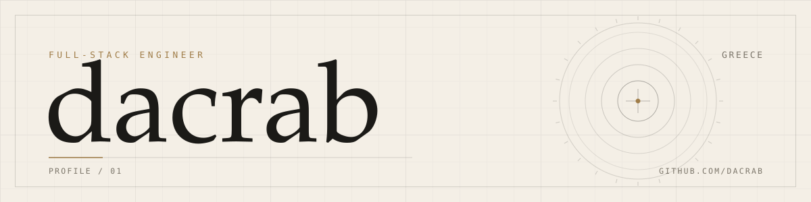

<picture>
  <source media="(prefers-color-scheme: dark)" srcset="assets/banner-dark.svg">
  
</picture>

Full-stack engineer based in Greece. Working across TypeScript, Kotlin, Svelte, Go, C#, and Java.

## Selected work

| Project | About |
| :--- | :--- |
| **[clubOS](https://github.com/dacrab/clubOS)** TypeScript · ★ 4 | Modern POS system for clubs & venues built with SvelteKit, Clerk, Drizzle, and Neon. |
| **[telestash](https://github.com/dacrab/telestash)** Kotlin | Google Photos-style gallery that uses Telegram as free, unlimited photo storage |
| **[craftops](https://github.com/dacrab/craftops)** Go | Go CLI for Minecraft server operations — Modrinth mod updates, backups, and Discord alerts. |
| **[topos](https://github.com/dacrab/topos)** TypeScript | High-performance Multi-Tenant SaaS for Real Estate Agencies built with Next.js, Neon, and Bun. |
| **[reddit-gallery-dl](https://github.com/dacrab/reddit-gallery-dl)** Go | A high-performance Reddit Gallery Downloader written in Go (Golang). Streams downloads on-the-fly for… |
| **[dragon-blaze](https://github.com/dacrab/dragon-blaze)** C# · ★ 5 | 2D action platformer built in Unity featuring fluid movement, combat systems, and modular architecture |

## Other projects

- [pardus](https://github.com/dacrab/pardus) — PARDUS — An avant-garde natural wine project landing page. Brutalist editorial, GSAP + Lenis, Astro + Tailwind CSS. CSS
- [portlane](https://github.com/dacrab/portlane) — A clean, modern client portal for freelancers and studios — projects, time tracking, and invoicing. Built with SvelteKit, Drizzle, and Neon. Svelte
- [fade-in](https://github.com/dacrab/fade-in) — Modern barbershop booking platform — TanStack Start + Convex + React TypeScript

## Recent pull requests

- [Redesign the interface around a warm paper palette and brass accent](https://github.com/dacrab/proteas/pull/79) — Merged · dacrab/proteas
- [fix(power): fall back to loginctl when a built-in command is missing](https://github.com/MalpenZibo/ashell/pull/1132) — Open · MalpenZibo/ashell
- [feat(ipc): allow forcing a state on the toggle commands](https://github.com/MalpenZibo/ashell/pull/1128) — Open · MalpenZibo/ashell
- [fix(brightness): stop step changes at the lowest usable level](https://github.com/MalpenZibo/ashell/pull/1127) — Open · MalpenZibo/ashell
- [feat(settings): compact the quick-settings menu and tooltips](https://github.com/MalpenZibo/ashell/pull/1126) — Open · MalpenZibo/ashell

## Stack

<picture>
  <source media="(prefers-color-scheme: dark)" srcset="assets/stack-dark.svg?v=83a487af">
  
</picture>
